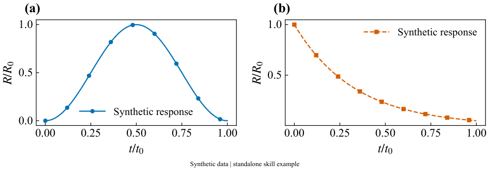
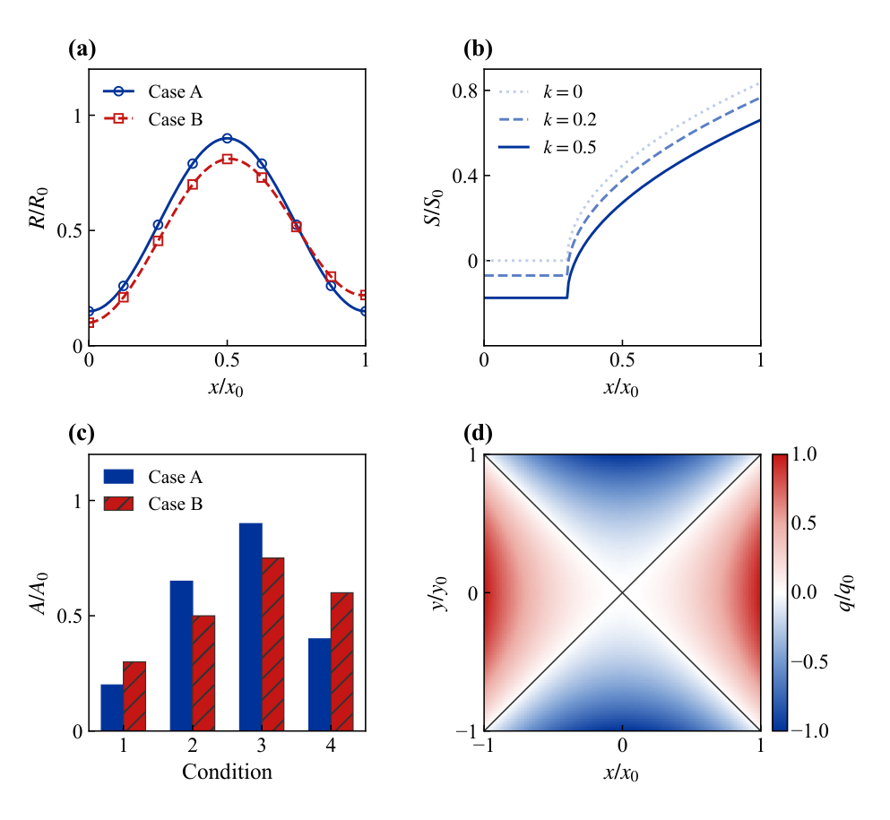

# Personal Scientific Plotting

一套基于 **Python / Matplotlib** 的个人科研绘图 skill，包含基础风格与 PRL 参考风格两套模板。统一字体、字号、子图编号、色条、布局和导出方式，同时保留数据来源与处理记录。

这是可独立复制的 skill 目录，也可作为 GitHub 仓库根目录。无需原开发项目、论文数据或其他 scientific skills。版本：**1.0.0**。

## 两套模板

| 项目 | 基础风格（默认） | 模板一：PRL 风格 |
|---|---|---|
| 模板 ID | `house-times-v3` | `prl-inspired-v1` |
| 字体 | Times New Roman + STIX 数学字体 | 同左 |
| 标签 / 刻度 / 图例 / 编号 | 13 / 12 / 11 / 14 pt | 同左 |
| 类别颜色 | 蓝、朱红、绿、紫等 | 深蓝、红为主，橙、绿等辅助 |
| 曲线 / 图框 | 1.2 / 0.65 pt | 1.5 / 0.8 pt |
| 布局 | 按内容灵活组合 | 优先正方形或近方形图框 |
| 云图 | 基础顺序、发散、循环配色 | 白红顺序色图、蓝白红发散色图；相位仍用循环配色 |

两套模板是个人规范。PRL 风格来自用户认可的参考图外观，不等于 PRL 官方制图要求；原截图的精确字体、pt 字号和物理尺寸无法完全恢复。

基础样图（解析演示数据）：



PRL 风格样图（解析公式与明确给定的演示数组）：



## 可以做什么

- 绘制曲线、散点/标记、柱图、二维云图、矢量方向图、极坐标图及局部放大。
- 使用规则网格、横/纵三图、2×3矩阵、上通栏下三图、左大右双图、混合与嵌套组合。辅助函数提供布局起点，图例与长标签仍需结合内容检查。
- 默认保留左上方 `(a)、(b)…` 编号，不自动添加 `W5: 200.034 Hz` 等工况标题。
- 统一色条宽度3 mm、间距2.4 mm，保留数字、隐藏刻度短线；多行云图采用每图或每行一根。
- 按量的含义选择配色与归一化；保留延拓支路顺序、缺失区域、带符号量和原始网格。
- 导出 PDF、保留文字的 SVG、600 DPI PNG、PDF实际渲染预览与JSON记录。
- 从后续截图/PDF提取新的配色、线型或完整外观，形成版本化模板库。

颜色、线型、字体和布局属于外观；色限、参考值、归一化和数据筛选属于科学处理，不能因更换模板而悄悄变化。空间场需保持物理坐标等比例；曲线的正方形图框不意味着x/y单位必须等比例。

## 环境与安装

已验证环境为 **Python 3.12.10 / Windows**。`requirements.txt`记录已测试的直接依赖版本，不是跨平台完整锁文件；其他系统需检查依赖与字体后运行示例验证。

需要：NumPy、Matplotlib、Pillow、PyMuPDF。仅使用这些运行功能，不要求 pandas、LaTeX 或 scientific-visualization。

从本目录运行，建议使用独立环境：

```powershell
python -m venv .venv
.venv/Scripts/python.exe -m pip install -r requirements.txt
```

以下命令中的 `python` 应指向安装依赖的同一个解释器；也可直接写 `.venv/Scripts/python.exe`。已有合适环境时可直接使用。

**字体**：目标电脑需要已安装 Times New Roman；STIX 数学字体由 Matplotlib 提供。系统字体不随本仓库分发。缺少指定字体时会明确报错，不会静默换成别的字体。若要改字体，用独立 JSON 模板记录选择。

### 安装为 Codex skill

将本目录放到 `$CODEX_HOME/skills/personal-scientific-plotting`；未设置 `CODEX_HOME` 时使用 `~/.codex/skills/personal-scientific-plotting`。

以下 PowerShell 命令从本仓库根目录执行，只复制运行需要的文件，已有同名目录时停止，便于先备份或决定如何更新：

```powershell
$skillRoot = if ($env:CODEX_HOME) {
    Join-Path $env:CODEX_HOME 'skills'
} else {
    Join-Path $HOME '.codex/skills'
}
$installDir = Join-Path $skillRoot 'personal-scientific-plotting'
if (Test-Path -LiteralPath $installDir) { throw '目标已存在，请先备份或处理更新。' }
New-Item -ItemType Directory -Force -Path $installDir | Out-Null
foreach ($item in @('SKILL.md', 'README.md', 'requirements.txt', 'scripts', 'assets', 'references')) {
    Copy-Item -LiteralPath (Join-Path $PWD $item) -Destination $installDir -Recurse
}
```

不安装也能从当前目录运行下述示例。

## 怎么使用

### 1. 直接告诉 Codex

明确指定 skill、模板、数据和科学含义，例如：

> 使用 `$personal-scientific-plotting`，按基础模板绘制这个CSV的频响曲线。横轴frequency_hz，纵轴pressure_pa，单位Hz和Pa；保留各支路原始顺序，采用对数纵轴。

> 使用 `$personal-scientific-plotting` 的PRL模板绘制2×2组合图，每行一个色条；四张图比较同一物理量，使用共同色限。保留编号，不添加工况标题。

提供实际数据时，说明文件、列名、单位、工况/支路、幅值含义，以及是否归一化。风格模板不会替你推断RMS与峰值，也不会凭空补数据或误差条。

### 2. 运行自带示例

从本目录执行：

```powershell
python -B scripts/manage_profiles.py list
python -B scripts/example.py --output outputs/basic/demo
python -B scripts/prl_examples.py --output-dir outputs/prl
```

第二条生成基础双面板示例；第三条生成PRL单图和四面板图谱，附带实际演示CSV。所有演示都是明确的解析/构造数据，不是论文结果或实验数据。

默认保护已存在的图，确认重建时加 `--overwrite`：

```powershell
python -B scripts/prl_examples.py --output-dir outputs/prl --overwrite
```

### 3. 在自己的 Python 脚本中调用

先将已安装skill的 `scripts` 加入导入路径，也可把 `skill_dir` 指向本仓库目录：

```python
from pathlib import Path
import os
import sys

skill_dir = Path(os.environ.get('CODEX_HOME', str(Path.home() / '.codex'))) / 'skills' / 'personal-scientific-plotting'
sys.path.insert(0, str(skill_dir / 'scripts'))
os.environ.setdefault('MPLCONFIGDIR', str(Path('outputs/.cache').resolve()))

import numpy as np
import matplotlib.pyplot as plt
from houseplot import style_context, make_layout, plot_curve, series_style, export_figure

with style_context(profile='house-times-v3'):
    fig, axes = make_layout('single')
    ax = axes['A']
    x = np.linspace(0, 1, 101)
    plot_curve(ax, x, np.sin(np.pi * x)**2,
               **series_style(0), markevery=10, label='Analytic demo')
    ax.set(xlabel='$t/t_0$', ylabel='$R/R_0$')
    ax.legend()
    report = export_figure(fig, 'outputs/my_figure', {
        'data_kind': 'synthetic',
        'sources': [],
        'transformations': ['x=linspace(0,1,101); y=sin(pi*x)^2'],
        'caption': 'Analytic demonstration; not experimental data.',
    })
    plt.close(fig)

print(report['checks'])
```

切换外观：将profile改为 `prl-inspired-v1`。若还要采用PRL固定正方形组合布局，用 `from prl_examples import square_layout`，再调用 `fig, axes = square_layout()`；单图使用 `square_layout(single=True)`。

导出记录包括物理尺寸、PNG像素/DPI、实际字体、模板完整快照及指纹、代码/输出哈希和面板/色条几何。PDF嵌入字体；SVG保留可编辑文字，查看端仍需对应字体。密集云图可以栅格化，但高DPI不增加原始数据分辨率。

## 常用接口

| 接口 | 用途 |
|---|---|
| `style_context(profile=...)` | 局部应用样式，退出后恢复设置 |
| `series_style(i)` | 获取当前模板的颜色、线型和标记 |
| `make_layout(...)` / `panel_label(...)` | 布局与连续外置编号 |
| `plot_curve(...)` | 保留顺序和缺口，并报告异常数量 |
| `field_scale(arrays, kind)` | 联合色限；kind为magnitude、signed、phase或level |
| `rounded_level_scale(..., quantum=5)` | SPL等标量级的色限向外取整，不改原始样本 |
| `pressure_level(..., reference_pa=...)` | 显式参考声压的dB转换，不静默加下限 |
| `rectilinear_grid(...)` / `unit_vectors(...)` | 保留网格缺口、拒绝重复坐标，生成方向矢量 |
| `add_colorbar(...)` / `export_figure(...)` | 色条与多格式导出 |

## 增加新模板

1. 给出喜欢的截图/PDF，并说明想继承的是配色、字体、线型、布局还是整套外观。
2. 记录参考标识/哈希与提取证据，区分可观察值、估计值、假定值和用户确认值。截图不能证明原始字体、pt字号或DPI。
3. 在已有模板上只组合外观字段，生成draft；用演示数据和适合的真实数据验证。
4. 确认后保存新版本，保留旧图使用的版本与指纹。

例如新建 `appearance_patch.json`：

```json
{"series": [
  {"color": "#003399", "linestyle": "-", "marker": "o"},
  {"color": "#C41614", "linestyle": "--", "marker": "s"}
]}
```

然后执行：

```powershell
python -B scripts/manage_profiles.py compose --base house-times-v3 --patch appearance_patch.json --id my-blue-red --version 1.0.0 --output my-blue-red.json
python -B scripts/manage_profiles.py validate my-blue-red.json
python -B scripts/example.py --profile my-blue-red.json --output outputs/custom/demo
```

该操作生成新文件，不覆盖原模板。完整约定见[模板库与参考提取](references/template-library.md)。

## 与 scientific-visualization 的关系

本skill是日常绘图的主规范：采用这里的外观、代码和导出流程。原 `scientific-visualization` 可用于新图型或专项审查的通用参考；不需要每次同时加载，两套默认外观也不应相互覆盖。本skill不导入其代码，独立迁移不要求安装它。设计来源见[来源说明](references/sources.md)。

## 检查与目录

```powershell
python -B -m unittest discover -s tests -q
```

测试使用构造数据，检查支路顺序、缺失处理、语义色限、模板组合、实际字体、导出覆盖保护和关键布局几何；不需要论文文件。部分检查会临时生成图片与缓存，它们不进入版本库。导出后仍要目视检查PDF预览；自动检查不等于期刊认证或物理模型验证。

```text
personal-scientific-plotting/
├── README.md                 使用说明
├── SKILL.md                  Codex执行规则
├── requirements.txt          已测试直接依赖
├── scripts/                  示例、模板管理与houseplot库
├── assets/profiles/           两套有效模板
├── assets/previews/           自有演示数据的预览
├── references/               科学规则、布局、模板提取与迁移说明
└── tests/                    独立运行测试
```

发布目录不包含缓存、历史试验、研究原始数据、论文PDF、原始参考截图或系统字体。原参考截图留在本地研究记录，模板保留其哈希、参数估计与可复现的颜色节点。
